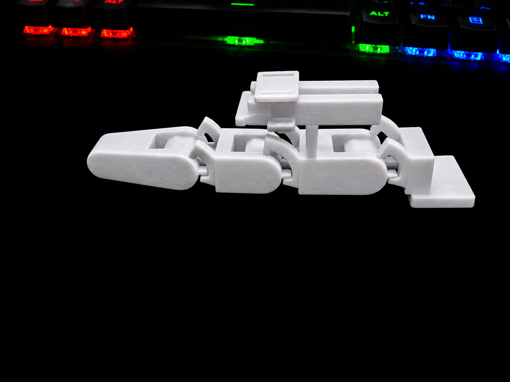

# Trazum

[English](README_EN.md) · [Presentación para hackatones](PITCH.md) · [Evidencia y demo](DEMO.md)

**Un proyecto estudiantil argentino que investiga cómo acompañar los movimientos de la escritura a mano.** Si sostener o mover un lápiz cuesta, el esfuerzo empieza antes de la primera letra. Trazum nació de una conversación durante una visita al Instituto Social Militar Dr. Dámaso Centeno, donde conocí esa dificultad. [Historia del proyecto](docs/HISTORIA.md)

Soy Lautaro Verón. Empecé Trazum como estudiante, a los 15 años. Mi objetivo a largo plazo es explorar un guante robótico que pueda acompañar movimientos de dedos y muñeca con sensores y actuadores. En esta etapa trabajo con simulaciones y prototipos de mesa.



*Índice de mesa en extensión, imagen aportada por el autor.* [Galería del índice](media/README.md)

## Simulador público

La demo independiente muestra un mecanismo articulado que mueve un lápiz virtual. Podés rotar y acercar la cámara, ejecutar o pausar una corrida, recorrer sus cuatro segundos con la línea de tiempo, cambiar la perturbación y la corrección, y volver a los valores iniciales. El gráfico compara dos movimientos sobre el mismo trazo sintético y muestra el error RMS y máximo.

La corrección usa la trayectoria objetivo conocida. Los valores están expresados en unidades virtuales. El simulador usa JavaScript, Three.js, Vite y Canvas 2D. [Arquitectura](docs/ARQUITECTURA.md)

### Ejecutarlo en tu equipo

Requiere Git y Node.js **22.12 o superior** con npm. La instalación descarga las dependencias. La demo se ejecuta de forma local, sin cuentas ni servicios pagos.

```sh
git clone https://github.com/fazmarmot-lgtm/Trazum.git
cd Trazum
npm ci
npm run dev
```

Abrí la dirección que imprime Vite, normalmente `http://localhost:5173`. Para correr las comprobaciones o servir la compilación de producción:

```sh
npm test
npm run build
npm run preview
```

## Qué se comprobó

| Evidencia | Resultado | Alcance |
| --- | --- | --- |
| Simulador público | 121 muestras reproducibles. Con los valores iniciales, el error RMS es 0,176 sin corrección y 0,062 con corrección. | Caso sintético con trayectoria conocida. |
| Índice impreso | El desarrollador informó que armó y flexionó a mano un índice de seis piezas en mesa. | Observación cualitativa de una unidad. |
| Auditorías digitales | Cero interferencias reportadas en 192 configuraciones del índice y 45 posturas de la mano compacta. | Los informes coinciden con las mallas de esas revisiones. |

La mano completa motorizada, la integración con sensores y el reconocimiento de intención siguen pendientes. La próxima prueba de mesa busca medir fuerza y recorrido durante varios ciclos. El efecto sobre la escritura y el uso sobre una persona quedan por evaluar. **Trazum es un prototipo experimental. Todavía no tiene validación como dispositivo médico.** [Desarrollo y resultados](docs/DESARROLLO.md) · [Limitaciones](docs/LIMITACIONES.md)

## IA y presentación

Usé ChatGPT/Codex para desarrollo y documentación, y Claude y DeepSeek para revisar el diseño y los informes. La demo aplica cinemática y una corrección matemática sin modelos entrenados ni APIs de IA. [Declaración de IA](docs/USO_DE_IA.md)

El video de demostración queda pendiente de grabación. [Guion y evidencia](DEMO.md) · [Preguntas del jurado](PREGUNTAS.md)
