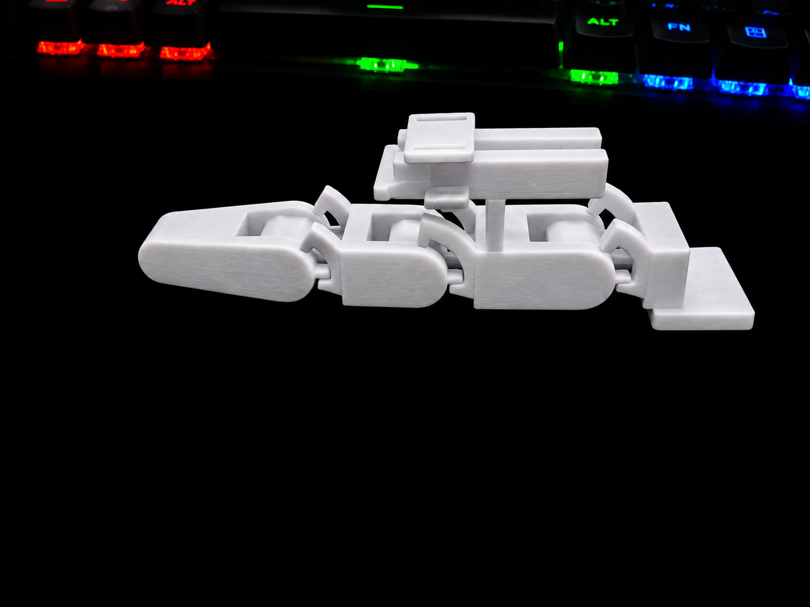

# Trazum

[Español](README.md) · [Hackathon pitch](PITCH.md#english) · [Demo and evidence](DEMO.md)

**An Argentine student project exploring how technology could support handwriting movements.** When holding or moving a pencil takes effort, the challenge begins before the first letter. Trazum grew out of a conversation during a visit to Instituto Social Militar Dr. Dámaso Centeno, where I learned about this difficulty. [Project story in Spanish](docs/HISTORIA.md)

I'm Lautaro Verón. I started Trazum as a student at age 15. My long-term goal is to explore a robotic glove that could support finger and wrist movements through sensors and actuators. The current work consists of simulations and bench prototypes.



*Bench index finger in extension, image supplied by the developer.* [Index finger gallery](media/README.md)

## Public simulator

A standalone demo moves a virtual stylus with an articulated mechanism. Orbit or zoom the camera, run or pause the four-second trace, scrub the timeline, adjust the disturbance and correction, or reset the run. The plot compares both motions against the same synthetic reference and reports RMS and peak error.

The correction has access to the known target. Measurements use virtual units. The demo is built with JavaScript, Three.js, Vite, and Canvas 2D. [Architecture in Spanish](docs/ARQUITECTURA.md)

### Run locally

Install Git and **Node.js 22.12 or later** with npm. Installation downloads the dependencies. Running the demo requires no account or paid service.

```sh
git clone https://github.com/fazmarmot-lgtm/Trazum.git
cd Trazum
npm ci
npm run dev
```

Open the URL printed by Vite, usually `http://localhost:5173`. Run the tests or preview the production build with:

```sh
npm test
npm run build
npm run preview
```

## Evidence and current status

| Evidence | Result | Scope |
| --- | --- | --- |
| Public simulator | 121 reproducible samples. Default RMS error is 0.176 uncorrected and 0.062 with target correction. | Synthetic case with a known target. |
| Printed index finger | The developer reported assembling and flexing a six-piece prototype by hand on a bench. | Qualitative observation of one unit. |
| Digital audits | No interferences were reported in 192 sampled index configurations and 45 sampled full-hand poses. | The reports match the meshes for the audited revisions. |

A complete motorized hand, integrated sensing, and intention recognition are still pending. The next bench experiment will measure how much force is needed and how far the finger travels across repeated cycles. Effects on handwriting and use on a person still need evaluation. **Trazum is an experimental prototype that has not been validated as a medical device.** [Development and results](docs/DESARROLLO.md) · [Limitations](docs/LIMITACIONES.md)

## AI disclosure and demo video

I used ChatGPT/Codex for development and documentation, and Claude and DeepSeek for technical review. The standalone demo uses classical kinematics and mathematical correction. It has no trained model or AI API dependency. [AI disclosure in Spanish](docs/USO_DE_IA.md)

The demo video is pending recording. [Demo outline and evidence](DEMO.md) · [Jury Q&A](PREGUNTAS.md)
