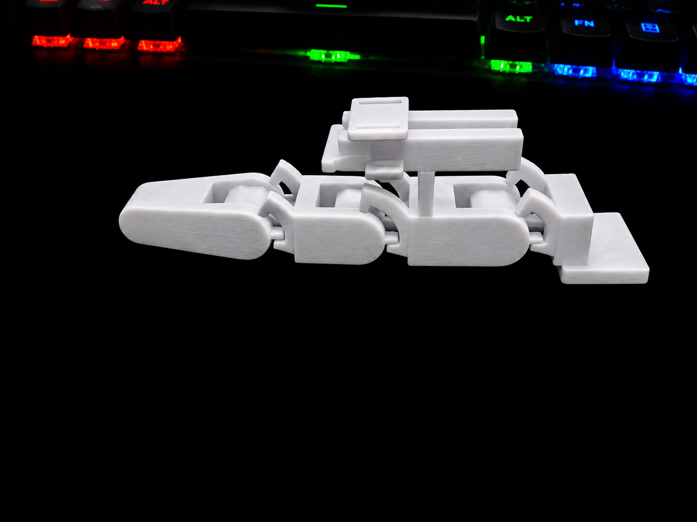
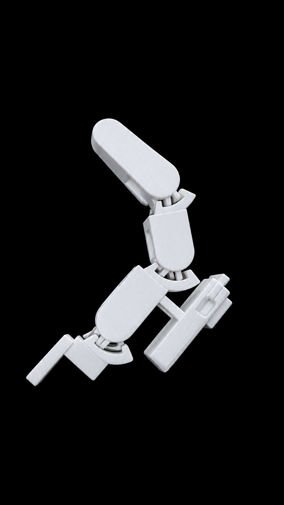
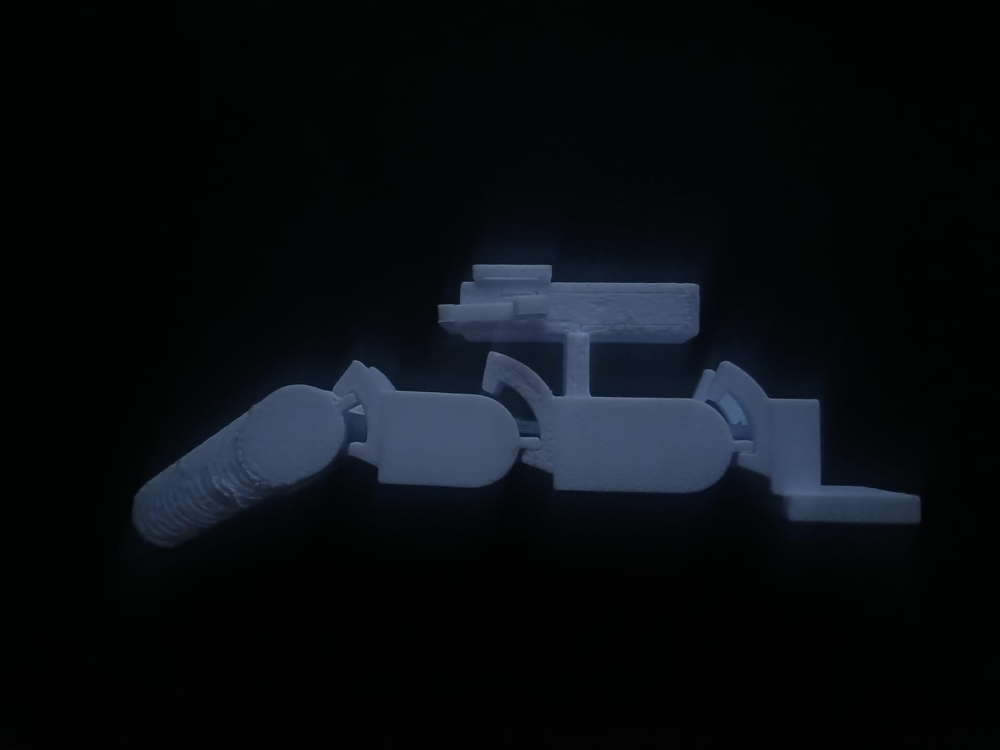
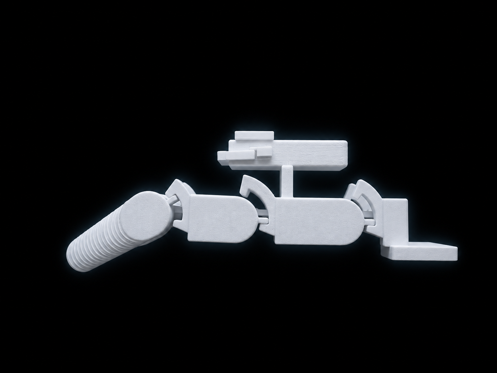

# Imágenes del índice · Index finger gallery

### Extensión · Extension

### Flexión · Flexion

### Perfil · Side view

### Ilustración generada con IA · AI-generated illustration

*Material ilustrativo para la presentación. Illustrative presentation material.*

Voy a sumar el enlace al video cuando esté listo. [Guion de la demostración](../DEMO.md)
